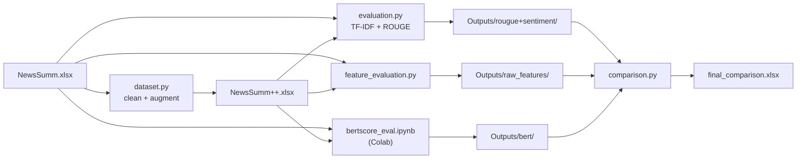

# Codebase Analysis

## Project Overview

This repository contains a Python workflow for preparing and comparing the
`NewsSumm` and `NewsSumm++` article-summary datasets. It cleans and augments
text, computes lexical, structural, entity, readability, overlap, TF-IDF
similarity, ROUGE, and BERTScore measurements, then exports Excel reports.

The code evaluates dataset/article-summary pairs; it does not train or run a
summary-generation model. In `dataset.py`, preprocessing can append up to three
article entities to a summary, so `NewsSumm++` is a transformed dataset rather
than output from a summarization model.

## Directory Structure

```text
.
├── Data/                         # Expected input workbooks (currently empty)
├── Outputs/
│   ├── bert/                     # Per-row BERTScore workbooks
│   ├── raw_features/             # Feature workbooks and aggregate comparison
│   └── rougue+sentiment/         # Per-row semantic/ROUGE scores and comparison
├── src/
│   ├── dataset.py                # Cleaning, preprocessing, and feature extraction
│   ├── evaluation.py             # TF-IDF semantic similarity and ROUGE evaluation
│   ├── feature_evaluation.py     # Dataset-level linguistic feature analysis
│   ├── comparison.py             # Combines metric workbooks into final report
│   └── bertscore_eval.ipynb      # Colab-oriented BERTScore evaluation
├── final_comparison.xlsx         # Existing merged comparison workbook
├── result table.md               # Existing interpretation of comparison results
└── Document.docx                 # Supporting document
```

`Outputs/` contains generated workbooks. The `.pyc` files in `__pycache__/` are
Python-generated caches, not source modules.

## Tech Stack

- **Language:** Python.
- **Data processing and Excel I/O:** pandas, NumPy, and `openpyxl`.
- **Text processing and metrics:** NLTK, scikit-learn (TF-IDF and stopwords),
  `rouge-score`, `textstat`, and spaCy with `en_core_web_sm`.
- **Progress display:** `tqdm`.
- **Contextual similarity:** `bert-score` and PyTorch, run in the notebook.
- **Execution environment:** Python scripts launched from the repository root;
  BERTScore notebook instructions target Google Colab.

There is no dependency manifest or automated test suite in the current
repository. These dependencies are inferred from imports and notebook
installation commands.

## Architecture

The workflow is a collection of scripts rather than a single orchestrated
application. It has three evaluation branches; the comparison script joins
their aggregate outputs.



The flow describes the intended relationship between the components. The
current scripts do not automatically connect every stage: their input and
output paths differ, as described below.

## Execution Flow and Data Flow

1. **Prepare the transformed dataset — `src/dataset.py`.** Loads an Excel
   workbook, renames expected source columns, normalizes text, removes short
   rows and duplicate articles/summaries, removes selected noise strings,
   extracts article entities, and computes keyword density, readability, and
   compression ratio. It may append up to three missing article entities to
   each summary, assigns row IDs, and writes a processed workbook.
2. **Evaluate semantic and ROUGE metrics — `src/evaluation.py`.** Loads and
   samples up to 1,000 article-summary pairs per dataset using random seed 42.
   It computes TF-IDF cosine similarity between each article and its paired
   summary, plus ROUGE-1/2/L F-measures. It writes per-row results and an
   aggregate comparison workbook.
3. **Evaluate dataset features — `src/feature_evaluation.py`.** Samples up to
   5,000 pairs per dataset (seed 42), processes them in chunks, and calculates
   summary statistics for text length, compression, sentence structure,
   vocabulary, entities, readability, and article-summary overlap. Entity
   features use spaCy; readability uses `textstat`.
4. **Compute BERTScore — `src/bertscore_eval.ipynb`.** In Colab, the notebook
   reads each workbook from Google Drive, samples up to 200 rows, compares
   summaries against articles, and saves per-row F1 scores. The notebook is a
   separate manual step; its outputs must be placed in `Outputs/bert/` for the
   merger.
5. **Merge metrics — `src/comparison.py`.** Reads the aggregate ROUGE/semantic
   and feature workbooks, averages the BERTScore columns, maps metric names to
   display labels and categories, and writes `final_comparison.xlsx`.

The scripts exchange Excel workbooks rather than Python objects. The evaluation
branches retain per-row outputs in their respective `Outputs/` directories and
produce aggregate tables consumed by the merger.

## Key Modules and Functions

- **`src/dataset.py`**
  - `clean_text`, `remove_noise`: normalize whitespace and remove selected
    boilerplate.
  - `remove_short_entries`, `remove_duplicates`: filter rows.
  - `batch_extract_entities`, `keyword_density`, `readability`,
    `compression_ratio`: extract preprocessing features.
  - `enhance_summary`: append selected entities from the article to a summary.
  - `process_chunk`, `process_dataset`: apply chunked preprocessing and export
    the processed workbook.
- **`src/evaluation.py`**
  - `load_data`: normalize the expected article and summary columns and sample
    rows.
  - `compute_semantic`, `compute_rouge`: calculate TF-IDF cosine similarity
    and ROUGE F-measures.
  - `evaluate`, `create_comparison`, `main`: calculate per-dataset and
    cross-dataset results.
- **`src/feature_evaluation.py`**
  - `compute_basic_features`, `compute_vocab_features`,
    `compute_entity_features`, `compute_readability_features`,
    `compute_overlap_features`: calculate feature groups.
  - `aggregate_metrics`: summarize row-level features.
  - `process_dataset`, `main`: sample, process in chunks, and write feature
    reports.
- **`src/comparison.py`**
  - `extract_bertscore`, `merge_metrics`, `add_categories`: normalize and
    combine metric tables.
  - `main`: write the formatted final workbook.
- **`src/bertscore_eval.ipynb`** contains the two dataset-specific BERTScore
  notebook cells; it is not exposed as a Python command-line module.

## Setup and Execution

No `requirements.txt`, `pyproject.toml`, or other dependency manifest is
present. A starting installation based on the code imports is:

```powershell
python -m pip install pandas numpy openpyxl nltk spacy scikit-learn textstat tqdm rouge-score bert-score torch
python -m spacy download en_core_web_sm
```

NLTK's `punkt` and `stopwords` resources are requested by the scripts when they
run. The BERTScore notebook separately includes a Colab install cell and reads
from `/content/drive/MyDrive/`.

Run scripts from the repository root because their data paths are relative to
the current working directory:

```powershell
python src\dataset.py
python src\evaluation.py
python src\feature_evaluation.py
python src\comparison.py
```

Before running, supply the workbooks with the column names expected by each
script. **The paths currently do not form a drop-in sequential pipeline:**

- `src/dataset.py` reads `Newssumm.xlsx` from the repository root and writes
  `NewsSumm++.xlsx` to the repository root.
- `src/evaluation.py` and `src/feature_evaluation.py` expect
  `Data/NewsSumm.xlsx` and `Data/NewsSumm++.xlsx`.
- `src/feature_evaluation.py` writes per-dataset features under `Data/`, while
  `src/comparison.py` consumes the aggregate feature workbook under
  `Outputs/raw_features/`.
- `src/comparison.py` also requires the ROUGE/semantic comparison workbook and
  both BERTScore workbooks to exist in their expected `Outputs/` subfolders.

The repository's `Data/` directory is currently empty. Place or copy datasets
and intermediate outputs at the expected locations before running each stage.
The BERTScore stage must be run separately in the notebook environment, and
its resulting workbooks must be copied into `Outputs/bert/`.

## Improvements and Limitations

- **Unify paths and orchestration.** Use explicit command-line input/output
  arguments and a single documented pipeline; currently preprocessing output
  does not directly feed evaluation scripts, and the feature output locations
  differ from the comparison script's inputs.
- **Declare and validate dependencies.** Add a dependency manifest, document
  supported Python versions, and validate the required spaCy model and NLTK
  resources rather than relying on runtime downloads.
- **Make preprocessing reproducible and interpretable.** Entity-appending
  changes reference summaries and can affect ROUGE, overlap, and BERTScore.
  Preserve original summaries and clearly label transformed data when
  measuring dataset quality.
- **Make metric comparisons consistent.** Current scripts use different
  sample sizes (up to 1,000, 5,000, and 200), and BERTScore is a manual
  notebook step. Align sample definitions and persist row identifiers to
  support paired comparisons.
- **Clarify metric semantics.** TF-IDF and ROUGE compare the article directly
  with its summary, not a generated system summary with a reference. These
  scores therefore describe article-summary similarity, not model performance.
- **Improve robustness and scale.** Validate workbook schemas and empty input
  cases, report errors with context, avoid repeated per-row similarity calls
  where vectorized operations are possible, and make spaCy/transformer compute
  settings configurable.
- **Add automated tests.** Cover cleaning, feature calculations, schema
  handling, metric aggregation, and output path expectations with small
  fixtures.
